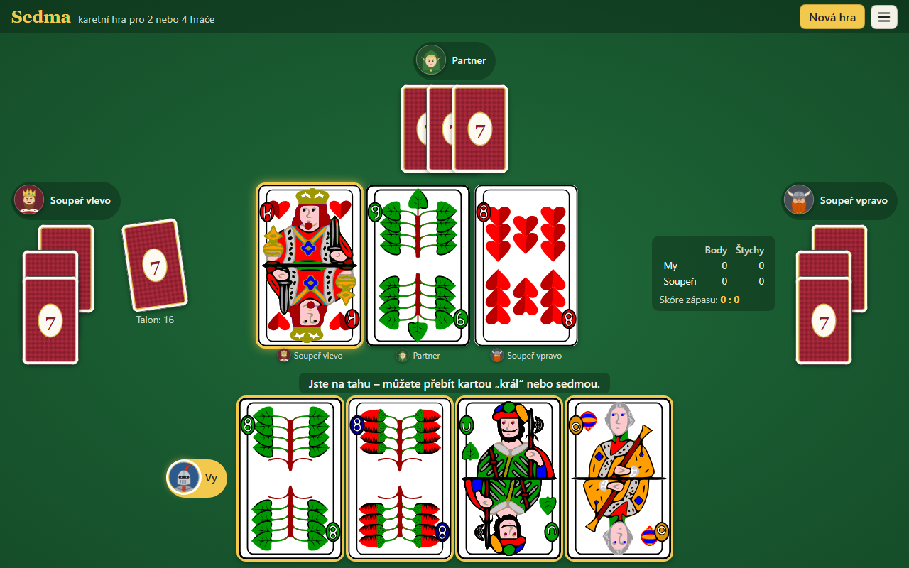

# Sedma



[🇨🇿 Česky](#česky) · [🇬🇧 English](#english)

---

## Česky

**Sedma** je oblíbená česká karetní hra pro 2 nebo 4 hráče s 32 kartami. Tahle verze
běží v prohlížeči jako čisté statické soubory (HTML + CSS + JavaScript), bez instalace
a bez serveru.

### Funkce

- **1 × 1** – vy proti počítači
- **2 × 2** – vy a počítačový partner (naproti) proti dvěma počítačovým soupeřům
- mariášové (německé) nebo francouzské karty
- čeština a angličtina (přepínač CZ / EN)
- počítání bodů, štychů a skóre zápasu (1 / 2 / 3 body za hru)
- funguje i na mobilu
- každý hráč má svůj avatar: rytíř (vy), čaroděj, elfí hraničář, král a trpaslík

### Jak hrát

1. Otevřete `index.html` v prohlížeči (stačí dvojklik), nebo spusťte jednoduchý server:
   ```sh
   npx http-server .
   # nebo
   python -m http.server
   ```
2. V menu (☰ vpravo nahoře) vyberte režim, balíček a jazyk, případně zapněte průběh hry.
   Klikněte na **Nová hra**.
3. Karty, které smíte zahrát, jsou zvýrazněné zlatě. Když jste vynášeli a můžete otočit
   kolo, stačí kliknout na kartu stejné hodnoty nebo sedmu, nebo na kulaté tlačítko
   **Otočit kolo** vpravo od karet. Tlačítkem **Nechat štych** (nebo **Vzít štych**)
   kolo ukončíte.

Užitečné parametry v URL: `?mode=4` (2 × 2), `?lang=en`, `?deck=french`.

### Pravidla ve zkratce

- Každý dostane 4 karty, zbytek je talon.
- Barvy nehrají roli. Štych přebije karta **stejné hodnoty** jako první vynesená karta,
  nebo **sedma** (žolík).
- Štych bere ten, kdo poslední přebil. Po každém kole může vynášející **otočit kolo**,
  pokud má další kartu stejné hodnoty nebo sedmu, a to i když štych drží jeho strana.
- Body mají jen **esa a desítky** (10 b.) a **poslední štych** (10 b.) – celkem 90.
- Po štychu se všichni doberou do 4 karet, vítěz štychu bere první a vynáší.

Podrobná pravidla a popis implementace: [docs/RULES.md](docs/RULES.md).

### Testy

```sh
npm test      # nebo: node --test tests/engine.test.js
```

Testy ověřují pravidla a odehrají tisíce simulovaných her (kontrola, že se rozdá všech
32 karet a rozdělí 90 bodů, a že AI poráží náhodného hráče).

---

## English

**Sedma** ("Seven") is a popular Czech trick-taking card game for 2 or 4 players with
a 32 card deck. This version runs in the browser as plain static files (HTML, CSS and
JavaScript), with nothing to install and no server.

### Features

- **1 vs 1**: you against the computer
- **2 vs 2**: you and a computer partner (sitting opposite) against two computer opponents
- German suited (traditional Czech) or French suited cards
- Czech and English UI (CZ / EN toggle)
- points, tricks and match score (1 / 2 / 3 points per game)
- works on phones
- every player has an avatar: knight (you), wizard, elf ranger, king and dwarf

### How to play

1. Open `index.html` in a browser (a double-click works), or serve the folder:
   ```sh
   npx http-server .
   # or
   python -m http.server
   ```
2. Open the menu (☰, top right) to choose the mode, deck and language, or to show the
   game log. Click **New game**.
3. Cards you may play are outlined in gold. When you led and can turn the round, just
   click a card of the led rank or a seven, or the round **Turn the round** button to the
   right of your hand. The **Give up the trick** (or **Take the trick**) button ends the
   round instead.

URL parameters: `?mode=4` (2 vs 2), `?lang=cs`, `?deck=french`.

### Rules in short

- Everyone gets 4 cards; the rest is the stock.
- Suits don't matter. A card of the **same rank** as the led card, or any **seven**
  (wild), takes over the trick.
- Whoever beat it last takes the trick. After each round the leader may **turn the
  round** (continue) with another card of the led rank or a seven, even if their own
  side holds the trick.
- Only **aces and tens** (10 each) and the **last trick** (10) score: 90 in total.
- After each trick everybody draws back up to 4 cards. The trick winner draws first
  and leads next.

Full rules and implementation notes: [docs/RULES.md](docs/RULES.md).

### Tests

```sh
npm test      # or: node --test tests/engine.test.js
```

## Project structure

```
index.html            page
css/style.css         styles
js/engine.js          game rules (pure logic, also runs in Node)
js/ai.js              computer player
js/i18n.js            Czech / English texts
js/ui.js              rendering and game flow
assets/cards/         card images (+ CREDITS.md)
assets/avatars/       player avatars (original, MIT)
docs/RULES.md         rules and how they are implemented
tests/                Node tests
```

## License

- Code: [MIT](LICENSE)
- Card art: **not MIT**, see [assets/cards/CREDITS.md](assets/cards/CREDITS.md)
  - German suited cards © Gunter Gerhardt (XSkat), [CC BY-SA 3.0](https://creativecommons.org/licenses/by-sa/3.0/), via Wikimedia Commons
  - French suited cards by Dmitry Fomin, [CC0](https://creativecommons.org/publicdomain/zero/1.0/), via Wikimedia Commons / [skaat-deck](https://github.com/nikku/skaat-deck)
